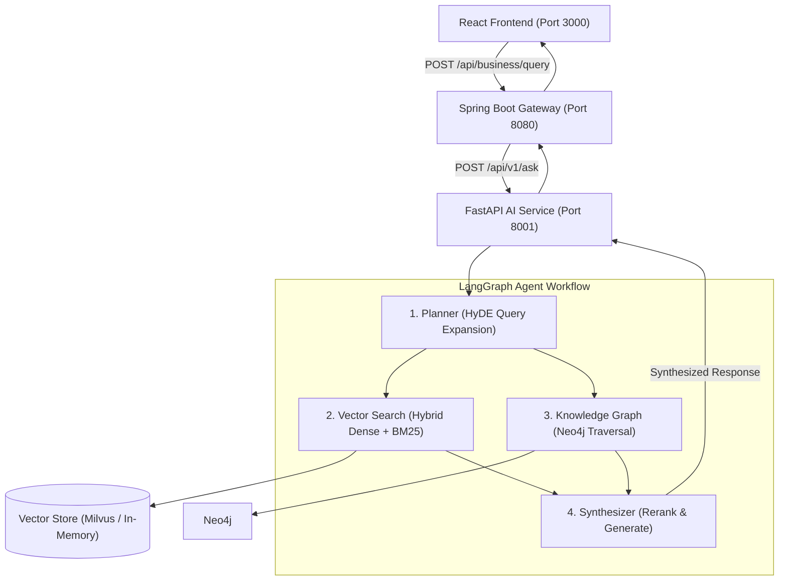

# Enterprise GraphRAG System

This project is an end-to-end Graph Retrieval-Augmented Generation (GraphRAG) platform. It demonstrates how to combine structured knowledge graphs and unstructured vector search to answer complex questions about microservice architectures, system dependencies, and failure domains.

The system is built across three distinct tiers:
- **Frontend**: A React 18 and TypeScript dashboard for submitting queries, exploring interactive graph visualizations, inspecting vector matches, and tracking multi-agent execution steps in real time.
- **Business Gateway**: A Spring Boot service that acts as an enterprise entry point for query validation, audit logging, and routing.
- **AI Microservice**: A FastAPI application powered by LangGraph that orchestrates specialized retrieval agents (HyDE expansion, hybrid search with MMR, knowledge graph traversal, and reranked synthesis).

---

## Architecture Overview



---

## Services and Ports

| Tier | Service | Port | Health Check | Role |
|---|---|---|---|---|
| Tier 1 | Frontend Dashboard | 3000 | http://localhost:3000 | Interactive UI with graph visualizer and agent trace logs |
| Tier 2 | Business Gateway | 8080 | http://localhost:8080/api/business/health | Spring Boot proxy for enterprise business logic and audit trails |
| Tier 3 | AI Microservice | 8001 | http://localhost:8001/health | LangGraph multi-agent pipeline executing retrieval and synthesis |

---

## How Retrieval Works

When a query is submitted, the AI microservice runs a coordinated 4-step workflow:

1. **Query Expansion (HyDE)**: Generates a hypothetical technical answer to capture deeper semantic intent before searching vector indices.
2. **Hybrid Vector Search**: Combines dense semantic search with sparse keyword search (BM25) and applies Maximal Marginal Relevance (MMR) to minimize redundancy.
3. **Graph Traversal**: Queries connected entities, relationships, and dependencies from Neo4j (such as service-to-service calls, database bindings, and auth checkpoints).
4. **Cross-Encoder Reranking and Synthesis**: Consolidates vector and graph findings, reranks relevant context passages by cross encoder scoring, and synthesizes a final response. If an OpenAI API key is configured, it calls GPT-4o; otherwise, it produces a structured synthesis from retrieved context.

---

## Quick Start

### Option A: Using Startup Scripts (Windows)

To launch all three services in separate command windows:
```powershell
.\start.bat
```

Open your browser at **http://localhost:3000**.

To stop all services:
```powershell
.\stop.bat
```

### Option B: Running Services Individually

If you prefer running each component manually for development:

1. **Python AI Microservice**:
   ```bash
   cd backend-python
   python -m venv venv
   .\venv\Scripts\activate
   pip install -r requirements.txt
   uvicorn app.main:app --host 0.0.0.0 --port 8001 --reload
   ```

2. **Java Business Gateway**:
   ```bash
   cd backend-java
   ./mvnw.cmd spring-boot:run
   ```

3. **Frontend Dashboard**:
   ```bash
   cd frontend
   npm install
   npm run dev
   ```

---

## Configuration

### Environment Variables (`backend-python/.env`)

Create a `.env` file inside `backend-python/` (or copy from `.env.example`):

```env
# Optional: OpenAI API Key for live LLM generation
OPENAI_API_KEY=your_openai_api_key_here

# Optional: Neo4j database connection
NEO4J_URI=bolt://localhost:7687
NEO4J_USERNAME=neo4j
NEO4J_PASSWORD=password

---

## Project Structure

```
enterprise-graphrag-system/
├── backend-java/                  # Spring Boot 3.2.0 Business Gateway
│   ├── mvnw.cmd                   # Maven wrapper for Windows
│   ├── pom.xml                    # Maven dependencies and build settings
│   └── src/main/java/com/graphrag/
│       ├── GraphragApplication.java
│       └── controller/QueryController.java
├── backend-python/                # FastAPI + LangGraph AI Microservice
│   ├── app/
│   │   ├── main.py                # REST endpoints and CORS settings
│   │   ├── agent.py               # Multi-agent StateGraph definition
│   │   └── retrieval.py           # HyDE, hybrid MMR, and graph retrieval logic
│   ├── requirements.txt           # Python package dependencies
│   └── .env.example               # Template environment configuration
├── frontend/                      # React 18 + TypeScript + Vite UI
│   ├── src/
│   │   ├── App.tsx                # Query console, graph explorer, and trace viewer
│   │   ├── main.tsx               # Application bootstrap
│   │   └── index.css              # Custom styling, dark palette, and layout
│   ├── package.json
│   ├── vite.config.ts
│   └── index.html
├── k8s/                           # Infrastructure definitions
│   ├── docker-compose-infra.yml   # Neo4j container setup
│   └── python-ai-deployment.yaml  # Kubernetes deployment manifest
├── start.bat                      # Startup automation script
└── stop.bat                       # Shutdown automation script

---
